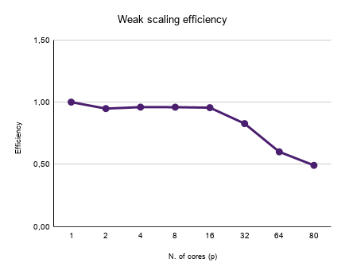
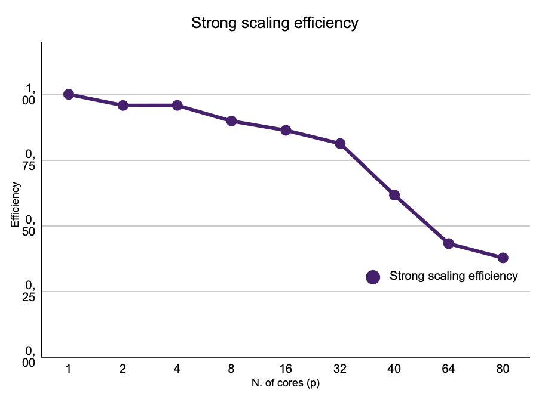
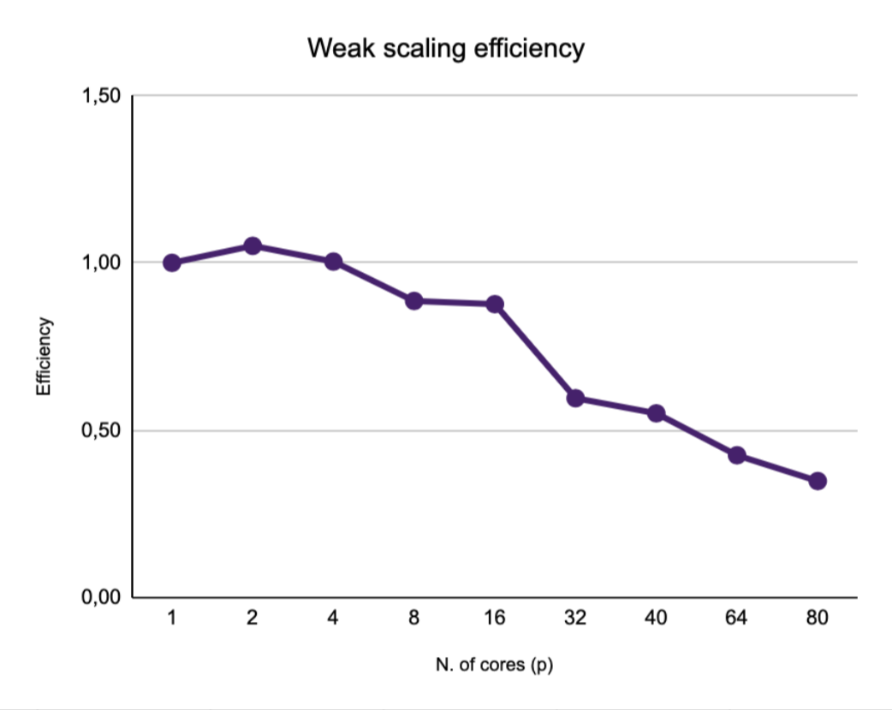

# Estimating the Area of a Convex Figure with the Monte Carlo Method

**IN480 - Project**

**Author:** Tommaso Signorini

## Table of Contents

- [Abstract](#abstract)
- [1. Standard OpenMP](#1-standard-openmp)
  - [1.1 Code Logic](#11-code-logic)
  - [1.2 Problems Encountered and Solutions](#12-problems-encountered-and-solutions)
  - [1.3 Performance Analysis: Strong and Weak Scaling](#13-performance-analysis-strong-and-weak-scaling)
- [2. MPI](#2-mpi)
  - [2.1 Code Logic](#21-code-logic)
  - [2.2 Problems Encountered and Solutions](#22-problems-encountered-and-solutions)
  - [2.3 Performance Analysis: Strong and Weak Scaling](#23-performance-analysis-strong-and-weak-scaling)

## Abstract

This project aims to develop an application in C, parallelized with the OpenMP standard, that estimates the area of an irregular convex figure (with a number of vertices $N$ between 4 and 1000) using the Monte Carlo method. The main architectural choices and implementation logic are analyzed below.

---

## 1. Standard OpenMP

### 1.1 Code Logic

The application reads a text file containing the 2D spatial coordinates of the figure's vertices, listed in counterclockwise order. To maximize the efficiency of the Monte Carlo method, the algorithm does not define a fixed sampling area in advance; instead, it dynamically computes a tight *Bounding Box* by sequentially iterating over the coordinates read. This ensures that random points are generated in a domain closely fitted to the figure, minimizing wasted computation and maximizing the accuracy of the estimate for a given number of samples.

The program takes the number of points $M$ to generate from the command line. Since the generation of each point and the corresponding check of its membership in the figure are strictly independent operations, the problem falls into the *embarrassingly parallel* category.

For parallel execution, a variable $K=0$ is initialized to count the points inside the figure. The outer loop over the samples is parallelized by delegating the random generation of points to the various OpenMP threads. To avoid *data races*, the update of the global counter is handled with the `reduction(+:K)` construct. At the end of the parallel region, $K$ holds the total number of valid points; the ratio $K/M$ multiplied by the area of the *Bounding Box* gives the final estimate of the figure's area.

To determine whether a generated point belongs to the figure, a half-plane test based on the 2D cross product was chosen. Given two adjacent vertices $A$ and $B$ and a random point $P$, the cross product of the oriented segments $AB$ and $AP$ is computed. If $P$ lies in the left half-plane with respect to segment $AB$, the cross product is positive. For the point to be strictly inside the convex polygon, this condition must hold for all $N$ segments of the figure. This check is implemented by the `is_inside()` function, which, again using a sum-based logical *reduction* and SIMD directives, processes all segments and increments a control variable for every negative cross product. At the end of the loop, if the variable is zero, the point is inside the figure and the function returns `true`; otherwise, it returns `false`.

### 1.2 Problems Encountered and Solutions

During the implementation and optimization of the code, the following issues were encountered:

#### Thread safety in random number generation

Since the generation of random points was parallelized by assigning it to each thread independently, the standard `rand()` function could not be used, as it is not *thread-safe* because it relies on a shared memory area. The *thread-safe* function `erand48()` was therefore adopted. Each thread was given a private state, allocated locally (`unsigned short rng_state[3]`). To guarantee the statistical independence of the sequences generated by the different cores, the *seed* was initialized by combining the thread's unique ID with the system time.

#### Optimization of the `is_inside()` function

Initially, the point-membership check used an early exit: at the first negative cross product, the loop stopped and returned `false`. Although this mathematically reduces the number of floating-point operations for points outside the figure, it caused the CPU's *branch predictor* to fail continuously because of unpredictable conditional jumps, forcing the processor to repeatedly flush the computation *pipeline*.

As described above, replacing the conditional jumps with an "error sum" logic made it safe to use the `#pragma omp simd` directive. Forcing the CPU to evaluate all $N$ segments for every point kept the *pipeline* constantly saturated. Empirical *benchmarks* confirmed that the regularity of the vectorized code reduces execution times compared to the sequential approach with early exits.

#### Switching from AoS to SoA

In the first version, the vertices were loaded as an *array of structures* (AoS), with the $x$ and $y$ coordinates interleaved in memory. In addition, for every generated point, the `is_inside()` function computed the cross product with the following statement:

```c
double cross_product = (B.x - A.x) * (P.y - A.y) - (B.y - A.y) * (P.x - A.x);
```

Two joint changes were therefore introduced: converting the vertices to a *Structure of Arrays* (SoA), with the $x$ and $y$ coordinates in separate contiguous arrays, and precomputing the edge deltas in dedicated arrays. Indeed, it is easy to see that the quantities `(B.x - A.x)` and `(B.y - A.y)` are always the same, regardless of the point $P$ being checked.

| Number of points | AoS program (s) | SoA program (s) | Relative time (%) |
|:----------------:|:---------------:|:---------------:|:-----------------:|
| $1 \cdot 10^9$ | $74.84 \pm 0.95$ | $54.93 \pm 0.84$ | $73.90 \pm 1.26$ |
| $2 \cdot 10^9$ | $146.69 \pm 1.12$ | $107.92 \pm 1.16$ | $73.58 \pm 1.19$ |
| $3 \cdot 10^9$ | $217.76 \pm 1.53$ | $161.31 \pm 1.72$ | $74.08 \pm 1.04$ |
| $4 \cdot 10^9$ | $289.33 \pm 1.83$ | $215.31 \pm 1.96$ | $75.11 \pm 1.75$ |
| $5 \cdot 10^9$ | $363.03 \pm 2.25$ | $280.82 \pm 1.41$ | $77.38 \pm 1.43$ |

**Table 1.** Average execution times (in seconds) and percentage ratio between the optimized program and the baseline version as a function of the number of points processed. A percentage value of $75\%$ means that the optimized version takes three quarters of the original time, for a net saving of $25\%$. The measurements include the standard deviation computed over 20 runs.

From the data in Table 1, the execution time of the SoA program is $(74.80\pm1.50)\%$ of the time taken by the AoS version, which is a clear improvement.

#### Non-constant times in weak scaling

In the OpenMP weak scaling test, the times were not constant. The probable cause is the concurrent use of the university's DGX machine by other users, which introduces contention for cores and memory bandwidth. This issue may have affected the program's performance in general, since the DGX was partially occupied for the entire duration of the measurements.

### 1.3 Performance Analysis: Strong and Weak Scaling

To evaluate the scalability of the parallel implementation, two distinct experiments were carried out. In the first (*strong scaling*), the problem size is kept fixed while the number of OpenMP threads varies; in the second (*weak scaling*), the number of generated points grows proportionally to the number of threads, so as to keep the workload per thread constant.

#### Strong scaling

Table 2 reports the execution time as the number of threads varies, for a fixed total number of generated points.

| Threads | Run 1 [s] | Run 2 [s] | Run 3 [s] | Run 4 [s] | Run 5 [s] | Run 6 [s] | Run 7 [s] | Run 8 [s] | Run 9 [s] | Run 10 [s] |
|--------:|----------:|----------:|----------:|----------:|----------:|----------:|----------:|----------:|----------:|-----------:|
| 1  | 2137.64 | 2293.67 | 2219.61 | 2180.08 | 2306.73 | 2307.65 | 2198.15 | 2325.29 | 2236.65 | 2197.03 |
| 2  | 1152.02 | 1220.39 | 1222.82 | 1222.98 | 1233.63 | 1209.38 | 1210.69 | 1208.37 | 1204.86 | 1210.81 |
| 4  | 608.56  | 610.62  | 614.82  | 609.95  | 609.05  | 611.33  | 613.98  | 612.49  | 606.50  | 606.72  |
| 8  | 306.91  | 308.48  | 307.71  | 306.53  | 305.50  | 304.29  | 306.19  | 305.62  | 304.23  | 309.24  |
| 16 | 153.81  | 155.07  | 155.18  | 153.85  | 155.90  | 153.53  | 152.61  | 153.28  | 153.64  | 153.90  |
| 32 | 85.51   | 85.30   | 86.54   | 85.91   | 85.95   | 86.99   | 87.38   | 87.42   | 86.82   | 86.90   |
| 64 | 60.09   | 60.13   | 60.59   | 60.18   | 59.99   | 59.61   | 59.62   | 59.96   | 59.88   | 60.27   |
| 80 | 57.37   | 58.89   | 57.46   | 58.36   | 57.88   | 57.37   | 57.22   | 58.02   | 56.89   | 57.62   |

**Table 2.** Results of the strong scaling test, obtained by generating $1\times10^9$ points in each run (execution times in seconds).

From the data in Table 2 we obtain the average execution times, from which the speedup and efficiency as a function of the number of active threads are derived, as reported in the following table.

| Threads | Average time [s] | Speedup | Efficiency |
|--------:|-----------------:|--------:|-----------:|
| 1  | 2240.25 | 1.00  | 1.00 |
| 2  | 1209.60 | 1.85  | 0.93 |
| 4  | 610.40  | 3.67  | 0.92 |
| 8  | 306.47  | 7.31  | 0.91 |
| 16 | 154.08  | 14.54 | 0.91 |
| 32 | 86.47   | 25.91 | 0.81 |
| 64 | 60.03   | 37.32 | 0.58 |
| 80 | 57.71   | 38.82 | 0.49 |

**Table 3.** Average execution time (in seconds), speedup and efficiency of the strong scaling test.

Up to $32$ threads the speedup is in agreement with the ideal one, with efficiency ranging between $0.93$ and $0.81$. These results confirm a good parallelization of the code, which correctly exploits the available cores.
Going from $32$ to $64$ threads, the efficiency drops sharply (from $0.81$ to $0.58$). This drop is consistent with the saturation of the physical cores ($40$ on the DGX) and with increasing contention on the shared L3 cache: every access of `is_inside` to the vertex arrays consumes bandwidth on the interconnect towards the L3. As the number of active threads grows, the aggregate volume of these requests can saturate that bandwidth without ever involving RAM, as measured with cachegrind. The speedup and efficiency plots follow.

<p align="center">
  
  
</p>

**Figure 1.** Speedup (left) and efficiency (right) of the strong scaling test as a function of the number of threads.

Figure 2 shows that the wall-clock time decreases significantly up to $32$ threads, going from $2240.25$ seconds to $86.47$ seconds, after which the reduction becomes progressively smaller. This suggests that, beyond a certain threshold, adding cores brings no real benefit: overhead and bottlenecks begin to dominate, and so does the serial part of the code.

<p align="center">
  
</p>

**Figure 2.** Execution time (wall-clock time, in seconds) as a function of the number of cores $p$.

#### Weak scaling

In the weak scaling test, the amount of data grows proportionally to the number of threads, keeping the load per thread constant. Progressively larger numbers of points were generated, keeping the load per thread constant. The measured data are shown in the following table.

| Threads | Total points | Run 1 [s] | Run 2 [s] | Run 3 [s] | Run 4 [s] | Run 5 [s] | Run 6 [s] | Run 7 [s] | Run 8 [s] | Run 9 [s] | Run 10 [s] |
|--------:|-------------:|----------:|----------:|----------:|----------:|----------:|----------:|----------:|----------:|----------:|-----------:|
| 1  | 5,000,000   | 11.62 | 11.50 | 11.67 | 12.00 | 11.02 | 11.71 | 11.63 | 11.69 | 12.04 | 11.41 |
| 2  | 10,000,000  | 12.01 | 12.28 | 11.85 | 12.16 | 12.55 | 12.34 | 12.36 | 12.49 | 12.62 | 12.00 |
| 4  | 20,000,000  | 12.46 | 12.02 | 12.34 | 11.48 | 12.40 | 11.99 | 12.18 | 11.92 | 12.55 | 11.80 |
| 8  | 40,000,000  | 12.18 | 12.45 | 12.18 | 12.03 | 11.25 | 12.25 | 12.49 | 12.10 | 12.03 | 12.24 |
| 16 | 80,000,000  | 12.69 | 11.98 | 12.02 | 12.24 | 12.11 | 11.71 | 11.84 | 12.30 | 12.36 | 12.45 |
| 32 | 160,000,000 | 13.90 | 14.24 | 14.11 | 14.03 | 14.06 | 14.05 | 13.87 | 14.14 | 13.88 | 14.23 |
| 64 | 320,000,000 | 19.01 | 19.46 | 19.39 | 19.37 | 19.42 | 19.20 | 19.52 | 19.29 | 19.50 | 19.46 |
| 80 | 400,000,000 | 24.50 | 23.30 | 23.43 | 24.36 | 23.24 | 23.93 | 23.43 | 23.45 | 23.05 | 23.71 |

**Table 4.** Results of the weak scaling test (execution times in seconds).

Averaging the times in Table 4 gives the following results.

| Threads | Total points | Average time [s] | Efficiency |
|--------:|-------------:|-----------------:|-----------:|
| 1  | 5,000,000   | 11.63 | 1.00 |
| 2  | 10,000,000  | 12.27 | 0.95 |
| 4  | 20,000,000  | 12.11 | 0.96 |
| 8  | 40,000,000  | 12.12 | 0.96 |
| 16 | 80,000,000  | 12.17 | 0.96 |
| 32 | 160,000,000 | 14.05 | 0.83 |
| 64 | 320,000,000 | 19.36 | 0.60 |
| 80 | 400,000,000 | 23.64 | 0.49 |

**Table 5.** Average execution time (in seconds) and efficiency of the weak scaling test.

Weak scaling shows very good efficiency, around 0.95-0.96, up to 16 threads: the execution time stays almost constant even though the workload grows proportionally to the number of threads. Beyond this threshold the efficiency decreases, dropping to 0.83 with 32 threads and to 0.49 with 80. A possible cause of this drop lies in the characteristics of the machine used, which has 80 logical cores, corresponding to 40 physical cores with SMT (*simultaneous multithreading*): beyond 40 threads, two threads share the same execution units and the same cache, so the available hardware resources no longer double along with the load.

<p align="center">
  
</p>

**Figure 3.** Weak scaling efficiency as a function of the number of cores $p$.

---

## 2. MPI

### 2.1 Code Logic

The parallelization of the area computation with the Monte Carlo method in an MPI environment was designed following the *Single Program, Multiple Data* (SPMD) paradigm. To minimize network traffic and disk accesses, the algorithmic architecture was structured as a *Master-Worker* model articulated in four main phases:

1. **Initialization and I/O:** To avoid concurrent reads and file system bottlenecks, only the *Master* process (Rank 0) is in charge of reading the input file containing the number of vertices and their spatial coordinates.

2. **Distribution and local setup (Broadcast):** The *Master* sends the polygon geometry to all the processes in the *communicator* with a single collective operation (`MPI_Bcast`). Once the data is received, each node independently computes the *Bounding Box* and precomputes the edge deltas, eliminating any network overhead for these derived parameters.

3. **Parallel processing (Monte Carlo):** The overall workload (the $M$ points) is partitioned uniformly among the available processes. Each node runs its own simulation loop, generating random points with the `erand48()` function; to guarantee the statistical decorrelation of the trajectories, the *seed* of each process is initialized as a function of its own `rank`.

4. **Reduction and output (Reduce):** Once the local simulation is finished, the partial counts of the points that fell inside the polygon are summed and collected by the *Master* process through an `MPI_Reduce` operation. Finally, the *Master* uses the global count to compute the final area estimate and print the execution times.

### 2.2 Problems Encountered and Solutions

Moving the project from the shared-memory paradigm (OpenMP) to the distributed-memory one (MPI) required solving several issues related to the cluster's hardware architecture and to the optimization of network traffic. The main problems addressed and the corresponding solutions are reported below.

#### Cluster architectural limits and management of MPI "slots"

During the *strong scaling* and *weak scaling* phases on the server, launching a large number of processes interrupted the execution because the available "slots" were exhausted. By default, the MPI environment strictly maps one process per physical core in order to avoid the performance degradation caused by *context switching*. To complete the tests while fully exploiting the architecture, this limit had to be bypassed by enabling the use of logical cores via the `--use-hwthread-cpus` and `--oversubscribe` flags.

#### Network latency and memory aliasing for broadcast optimization

In an MPI environment, the communication start-up time (latency) dominates over raw bandwidth, especially for small messages. Sending the $X$ and $Y$ vertex coordinates from the *Master* node to the *Workers* would have required two separate calls to `MPI_Bcast`, doubling the network overhead. Creating a *custom datatype* (via `MPI_Type_contiguous`) would instead have introduced hidden *packing* and *unpacking* operations. The adopted solution allocates a single contiguous buffer of size $2N$, mapping the pointers $x$ and $y$ to the first and second half of the block, respectively. This made it possible to send the whole geometry with a single network operation, while preserving the readability of the mathematical formulas in the code.

#### Communication overhead vs. redundant computation

In the OpenMP version, the differences (deltas) between the coordinates of adjacent vertices were precomputed to reduce the computational load in the simulation loop. In MPI, if the *Master* had also computed and sent the delta vectors, the volume of transmitted data would have been needlessly doubled. Following a classic HPC optimization paradigm, it was decided to trade local clock cycles for network traffic: the *Master* sends only the vertices, after which each node independently precomputes the deltas in its own local memory before starting the stochastic integration.

#### Anomaly in strong scaling with two processes

In the strong scaling tests on the DGX, the time with $P=2$ was equal to that with $P=1$ ($\approx 1384$ s versus $\approx 1355$ s), while from $P=4$ the speedup was in line with expectations. The `--report-bindings` option showed that, with `--use-hwthread-cpus`, MPI mapped the two ranks onto the two hardware threads of the same physical core (`core 0[hwt 0]` and `core 0[hwt 1]`), which therefore shared a single compute unit. The script was modified by making mapping and binding explicit: `--map-by core --bind-to core` for $P \le 40$ and, only beyond the number of physical cores, `--use-hwthread-cpus --map-by hwthread --bind-to hwthread`.

#### I/O fragility and deadlock prevention

I/O handling in distributed systems is a potential source of stalls. In the code developed, reading the vertex file is delegated exclusively to the *Master* process. If the file format were corrupted, ignoring the return codes of the `fscanf` function would fill the buffer with random data, propagating the error to the whole cluster. Even worse, a silent block while reading would prevent the *Master* from reaching the `MPI_Bcast` barrier, leaving the other processes waiting indefinitely (*deadlock*). Rigorous checks on the *exit codes* of the reading routines were therefore implemented, together with calls to `MPI_Abort` to bring down the whole *communicator* in a safe and traceable way in case of anomalies.

### 2.3 Performance Analysis: Strong and Weak Scaling

As with OpenMP, the scalability of the MPI code is tested through strong and weak scaling; the results of these tests follow.

#### Strong scaling

Table 6 reports the execution time as the number of active processes varies, for a fixed total number of generated points, namely $1\times 10^9$.

| Processes | Run 1 | Run 2 | Run 3 | Run 4 | Run 5 | Run 6 | Run 7 | Run 8 | Run 9 | Run 10 |
|----------:|------:|------:|------:|------:|------:|------:|------:|------:|------:|-------:|
| 1  | 1361.26 | 1368.90 | 1346.16 | 1357.34 | 1354.81 | 1351.54 | 1349.55 | 1352.46 | 1365.58 | 1349.85 |
| 2  | 692.60  | 717.98  | 725.34  | 716.17  | 704.51  | 712.11  | 709.51  | 700.92  | 699.90  | 698.25  |
| 4  | 351.07  | 351.31  | 350.14  | 354.70  | 351.94  | 358.07  | 356.94  | 351.38  | 352.70  | 359.71  |
| 8  | 188.89  | 187.89  | 186.06  | 189.60  | 187.97  | 189.11  | 189.70  | 189.40  | 188.05  | 189.63  |
| 16 | 98.21   | 97.94   | 97.25   | 98.21   | 97.94   | 98.14   | 98.47   | 98.70   | 98.92   | 97.91   |
| 32 | 56.19   | 50.43   | 49.57   | 54.10   | 50.46   | 50.53   | 54.95   | 50.12   | 51.63   | 53.23   |
| 40 | 58.80   | 51.85   | 50.61   | 59.41   | 50.54   | 50.60   | 59.92   | 55.20   | 53.63   | 58.75   |
| 64 | 49.92   | 49.70   | 48.08   | 48.10   | 48.38   | 48.54   | 48.93   | 49.94   | 48.99   | 49.49   |
| 80 | 46.84   | 43.82   | 45.03   | 44.93   | 44.00   | 43.79   | 44.68   | 44.30   | 46.47   | 44.64   |

**Table 6.** Execution times (in seconds) of the 10 runs as the number of processes varies.

From the data in Table 6 we obtain the average execution times, from which the speedup and efficiency as a function of the number of active processes are derived, as reported in the following table.

| Processes | Average time (s) | Speedup | Efficiency |
|----------:|-----------------:|--------:|-----------:|
| 1  | 1355.75 | 1.00  | 1.00 |
| 2  | 707.73  | 1.92  | 0.96 |
| 4  | 353.80  | 3.83  | 0.96 |
| 8  | 188.63  | 7.19  | 0.90 |
| 16 | 98.17   | 13.81 | 0.86 |
| 32 | 52.12   | 26.01 | 0.81 |
| 40 | 54.93   | 24.68 | 0.62 |
| 64 | 49.01   | 27.66 | 0.43 |
| 80 | 44.85   | 30.23 | 0.38 |

**Table 7.** Average execution time, speedup and efficiency as the number of processes varies.

The average execution time goes from about $1355.75$ s with a single process to $44.85$ s with $80$ processes, with a maximum speedup of $30.23$. However, the scaling is not uniform. Table 7 shows that up to $32$ processes the efficiency is above $80\%$: the program is well parallelized and the gain in execution time is significant. From $40$ processes onwards the efficiency worsens sharply. This coincides with the saturation of the available physical cores on the DGX ($40$ cores, $80$ logical cores): with $64$ and $80$ processes, several processes share the same core, and in all these regimes the overheads (communication, synchronization, memory accesses) become dominant, so the execution time no longer scales proportionally. Moreover, from $32$ processes onwards the variability of the times across runs increases, as can be seen in Table 6. The plots derived from Table 7 follow.

<p align="center">
  
  
</p>

**Figure 4.** Speedup (left) and efficiency (right) of the strong scaling test as a function of the number of processes.

The following figure shows the wall-clock time stabilizing from $32$ active processes onwards.

<p align="center">
  
</p>

**Figure 5.** Execution time (wall-clock time, in seconds) as a function of the number of cores $p$.

#### Weak scaling

Similarly to what was done for OpenMP, weak scaling tests were also carried out here to assess the scalability of the MPI code. The measured data are shown in the following table.

| Processes | Total points | Run 1 | Run 2 | Run 3 | Run 4 | Run 5 | Run 6 | Run 7 | Run 8 | Run 9 | Run 10 |
|----------:|-------------:|------:|------:|------:|------:|------:|------:|------:|------:|------:|-------:|
| 1  | $1 \cdot 10^{7}$   | 18.85 | 12.53 | 16.90 | 16.75 | 15.17 | 17.76 | 17.72 | 15.47 | 12.71 | 15.75 |
| 2  | $2 \cdot 10^{7}$   | 13.54 | 17.73 | 13.30 | 15.75 | 14.87 | 16.99 | 13.00 | 17.81 | 15.61 | 13.29 |
| 4  | $4 \cdot 10^{7}$   | 14.07 | 16.57 | 18.30 | 15.86 | 14.97 | 17.01 | 16.31 | 16.71 | 14.29 | 14.93 |
| 8  | $8 \cdot 10^{7}$   | 18.85 | 18.42 | 17.68 | 18.27 | 16.16 | 17.98 | 17.44 | 18.16 | 19.80 | 17.38 |
| 16 | $1.6 \cdot 10^{8}$ | 19.61 | 18.47 | 17.70 | 18.45 | 18.45 | 17.36 | 18.16 | 18.27 | 17.79 | 17.87 |
| 32 | $3.2 \cdot 10^{8}$ | 26.99 | 27.19 | 28.30 | 26.14 | 26.07 | 27.15 | 27.03 | 26.57 | 26.71 | 26.03 |
| 40 | $4 \cdot 10^{8}$   | 28.68 | 29.61 | 29.39 | 29.02 | 28.64 | 29.06 | 28.81 | 29.32 | 28.61 | 29.15 |
| 64 | $6.4 \cdot 10^{8}$ | 37.47 | 37.72 | 37.65 | 37.67 | 38.61 | 37.27 | 37.17 | 37.55 | 36.42 | 38.58 |
| 80 | $8 \cdot 10^{8}$   | 46.29 | 46.45 | 46.50 | 45.30 | 47.37 | 44.88 | 45.28 | 46.06 | 45.57 | 45.98 |

**Table 8.** Execution times (in seconds) of the 10 runs in the weak scaling test, as the number of processes and the total number of points vary.

Averaging the times in Table 8 gives the following results.

| Processes | Total points | Average time (s) | Efficiency |
|----------:|-------------:|-----------------:|-----------:|
| 1  | $1 \cdot 10^{7}$   | 15.96 | 1.00 |
| 2  | $2 \cdot 10^{7}$   | 15.19 | 1.05 |
| 4  | $4 \cdot 10^{7}$   | 15.90 | 1.00 |
| 8  | $8 \cdot 10^{7}$   | 18.02 | 0.89 |
| 16 | $1.6 \cdot 10^{8}$ | 18.21 | 0.88 |
| 32 | $3.2 \cdot 10^{8}$ | 26.82 | 0.60 |
| 40 | $4 \cdot 10^{8}$   | 29.03 | 0.55 |
| 64 | $6.4 \cdot 10^{8}$ | 37.61 | 0.42 |
| 80 | $8 \cdot 10^{8}$   | 45.97 | 0.35 |

**Table 9.** Average execution time and weak scaling efficiency as the number of processes and the total number of points vary.

From this we obtain the weak scaling efficiency plot in Figure 6.

<p align="center">
  
</p>

**Figure 6.** Weak scaling efficiency as a function of the number of processes $p$.

The analysis of the execution times for the *weak scaling* test shows nearly ideal efficiency up to 16 processes. However, a first degradation appears from 32 processes onwards, followed by a further, more marked drop once the threshold of $40$ processes is exceeded.

The first drop cannot be attributed exclusively to architectural bottlenecks, but to the presence of other users on the compute node. Monitoring the system load in fact revealed intensive processes run by third parties that saturated some cores. The operating system scheduler was forced to map part of the MPI processes onto cores that were already congested; this inevitably affected the degradation of the *weak scaling* efficiency from $32$ processes onwards.

The second drop, evident in the tests with $64$ and $80$ processes, is instead structural: the server has $40$ physical cores available. Beyond this threshold, the additional processes were mapped onto the corresponding logical cores (Hyper-Threading). Different processes therefore had to share the same physical compute units, slowing down the execution of each individual task and, consequently, the whole parallel block.
