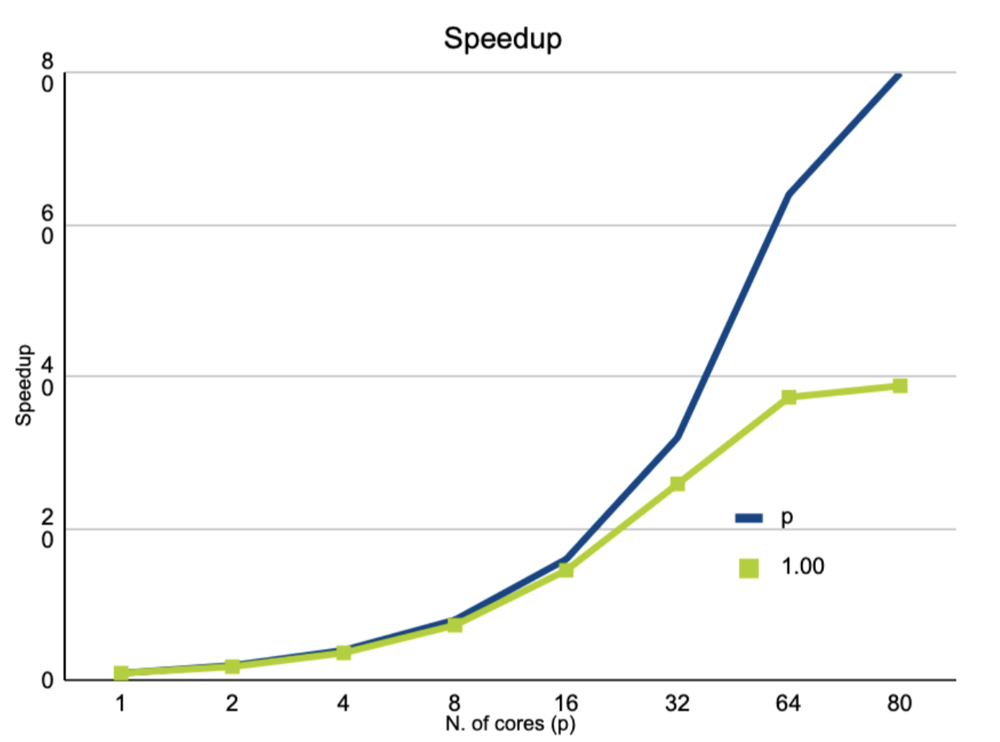
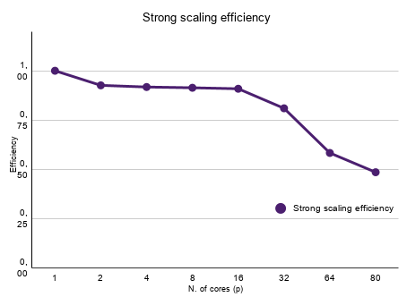
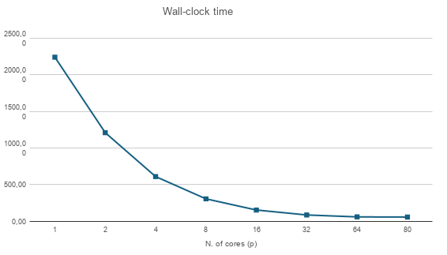
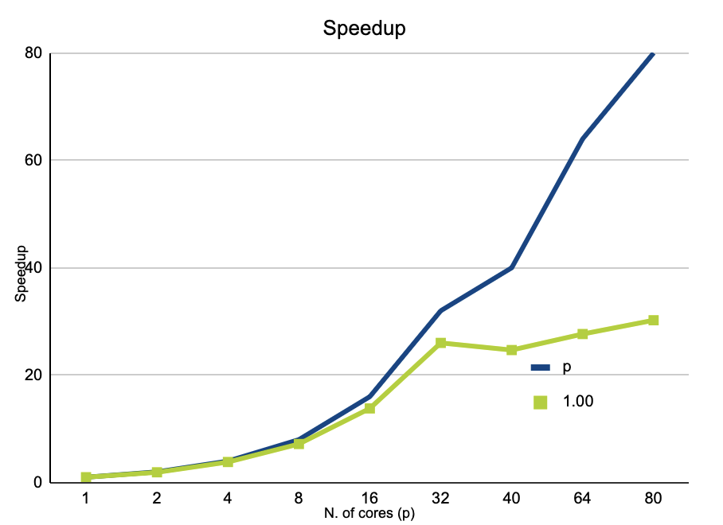
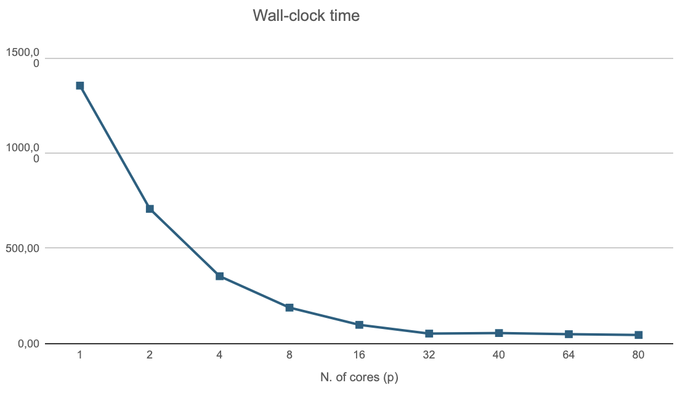

# Calcolo dell'area di una figura convessa tramite metodo Monte Carlo

**IN480 - Progetto**

**Autore:** Tommaso Signorini

## Indice

- [Abstract](#abstract)
- [1. Standard OpenMP](#1-standard-openmp)
  - [1.1 Logica del codice](#11-logica-del-codice)
  - [1.2 Problematiche incontrate e soluzioni](#12-problematiche-incontrate-e-soluzioni)
  - [1.3 Analisi prestazionale: strong e weak scaling](#13-analisi-prestazionale-strong-e-weak-scaling)
- [2. MPI](#2-mpi)
  - [2.1 Logica del codice](#21-logica-del-codice)
  - [2.2 Problematiche incontrate e soluzioni](#22-problematiche-incontrate-e-soluzioni)
  - [2.3 Analisi prestazionale: strong e weak scaling](#23-analisi-prestazionale-strong-e-weak-scaling)

## Abstract

Il presente progetto si pone l'obiettivo di sviluppare un'applicazione in linguaggio C, parallelizzata tramite lo standard OpenMP, per stimare l'area di una figura convessa non regolare (con un numero di vertici $N$ compreso tra 4 e 1000) utilizzando il metodo Monte Carlo. Di seguito vengono analizzate le principali scelte architetturali adottate e le logiche implementative.

---

## 1. Standard OpenMP

### 1.1 Logica del codice

L'applicativo acquisisce in input un file di testo contenente le coordinate spaziali 2D dei vertici della figura, ordinati in senso antiorario. Per massimizzare l'efficienza del metodo Monte Carlo, l'algoritmo non definisce un'area di campionamento fissa a priori, ma calcola dinamicamente un *Bounding Box* di aderenza massima iterando sequenzialmente sulle coordinate lette. Questo garantisce che i punti casuali vengano generati in un dominio strettamente aderente alla figura, minimizzando gli sprechi computazionali e massimizzando l'accuratezza della stima a parità di campioni.

Tramite riga di comando, il programma acquisisce il numero di punti $M$ da generare. Poiché la generazione di ciascun punto e il rispettivo controllo di appartenenza alla figura sono operazioni strettamente indipendenti, il problema rientra nella categoria *embarrassingly parallel*.

Per l'esecuzione parallela, viene inizializzata una variabile $K=0$ destinata a contare i punti interni alla figura. L'iterazione esterna sui campioni viene parallelizzata delegando la generazione casuale dei punti ai vari thread OpenMP. Per evitare *data race*, l'aggiornamento del contatore globale viene gestito tramite il costrutto `reduction(+:K)`. Al termine della regione parallela, $K$ contiene il totale dei punti validi; il rapporto $K/M$ moltiplicato per l'area del *Bounding Box* restituisce la stima finale dell'area della figura.

Per determinare l'appartenenza di un punto generato alla figura, si è optato per il test dei semipiani tramite prodotto vettoriale 2D. Dati due vertici adiacenti $A$ e $B$ e un punto casuale $P$, si calcola il prodotto vettoriale tra i segmenti orientati $AB$ e $AP$. Se $P$ si trova nel semipiano sinistro rispetto al segmento $AB$, il prodotto vettoriale risulta positivo. Affinché il punto sia strettamente all'interno del poligono convesso, tale condizione deve verificarsi per tutti gli $N$ segmenti della figura. Tale verifica viene implementata dalla funzione `is_inside()`, che utilizzando nuovamente una *reduction* logica a somma e direttive SIMD, elabora tutti i segmenti incrementando una variabile di controllo per ogni prodotto vettoriale negativo. A fine ciclo, se la variabile è pari a zero, il punto è interno alla figura e la funzione restituisce `true`; in caso contrario, restituisce `false`.

### 1.2 Problematiche incontrate e soluzioni

Durante l'implementazione e l'ottimizzazione del codice, sono state riscontrate le seguenti criticità:

#### Thread-safety nella generazione di numeri casuali

Siccome la generazione dei punti casuali è stata parallelizzata, affidandola a ciascun thread indipendentemente, non è stato possibile l'utilizzo della funzione standard `rand()`, non essendo questa una funzione *thread-safe* in quanto utilizza uno spazio di memoria condiviso. Pertanto è stata adottata la funzione *thread-safe* `erand48()`. A ogni thread è stato assegnato uno stato di memoria privato allocato localmente (`unsigned short rng_state[3]`). Per garantire l'indipendenza statistica delle sequenze generate dai vari core, il *seed* è stato inizializzato combinando l'ID univoco del thread con l'orario di sistema.

#### Ottimizzazione della funzione `is_inside()`

Inizialmente, l'algoritmo di controllo dell'appartenenza del punto prevedeva un'interruzione anticipata: al primo prodotto vettoriale negativo, il ciclo si interrompeva restituendo `false`. Pur riducendo matematicamente il numero di operazioni in virgola mobile per i punti esterni, questa scelta causava un continuo fallimento del *branch predictor* della CPU a causa dei salti condizionati imprevedibili, costringendo il processore a svuotare ripetutamente la *pipeline* di calcolo.

Come descritto in precedenza, l'eliminazione dei salti condizionati a favore di una logica a "somma di errori" ha permesso l'utilizzo sicuro della direttiva `#pragma omp simd`. Costringere la CPU a calcolare tutti gli $N$ segmenti per ogni punto ha garantito una *pipeline* sempre satura. I *benchmark* empirici hanno confermato che la regolarità del codice vettorializzato abbatte i tempi di esecuzione rispetto all'approccio sequenziale con le uscite anticipate.

#### Passaggio da AoS a SoA

Nella prima versione, i vertici venivano caricati come *array of structures* (AoS), con coordinate $x$ e $y$ interlacciate in memoria. Inoltre, per ogni punto generato, la funzione `is_inside()` eseguiva il prodotto vettoriale con il seguente comando:

```c
double cross_product = (B.x - A.x) * (P.y - A.y) - (B.y - A.y) * (P.x - A.x);
```

Sono state quindi introdotte due modifiche congiunte: la conversione dei vertici in *Structure of Arrays* (SoA), con coordinate $x$ e $y$ in array contigui separati, e il precalcolo dei delta dei lati in array dedicati. Infatti è facile notare che le quantità `(B.x - A.x)` e `(B.y - A.y)` sono sempre le stesse indipendentemente dal punto $P$ che si sta controllando.

| Numero di punti | Programma AoS (s) | Programma SoA (s) | Tempo relativo (%) |
|:---------------:|:-----------------:|:-----------------:|:------------------:|
| $1 \cdot 10^9$ | $74.84 \pm 0.95$ | $54.93 \pm 0.84$ | $73.90 \pm 1.26$ |
| $2 \cdot 10^9$ | $146.69 \pm 1.12$ | $107.92 \pm 1.16$ | $73.58 \pm 1.19$ |
| $3 \cdot 10^9$ | $217.76 \pm 1.53$ | $161.31 \pm 1.72$ | $74.08 \pm 1.04$ |
| $4 \cdot 10^9$ | $289.33 \pm 1.83$ | $215.31 \pm 1.96$ | $75.11 \pm 1.75$ |
| $5 \cdot 10^9$ | $363.03 \pm 2.25$ | $280.82 \pm 1.41$ | $77.38 \pm 1.43$ |

**Tabella 1.** Tempi medi di esecuzione (in secondi) e rapporto percentuale tra il programma ottimizzato e la versione base in funzione dei punti elaborati. Un valore percentuale del $75\%$ indica che la versione ottimizzata impiega i tre quarti del tempo originale, offrendo un risparmio netto del $25\%$. Le misurazioni includono la deviazione standard calcolata su 20 esecuzioni.

Dai dati in Tabella 1 si evince che il tempo di esecuzione del programma SoA è pari al $(74.80\pm1.50)\%$ del tempo impiegato dalla versione AoS, decretando quindi un netto miglioramento.

#### Tempi non costanti nel weak scaling

Nel test di weak scaling di OpenMP i tempi non risultavano costanti. La causa probabile è l'utilizzo concorrente della macchina DGX universitaria da parte di altri utenti, che introduce contesa su core e banda di memoria. Tale problematica potrebbe aver inciso in generale sulle prestazioni del programma, infatti la DGX risultava parzialmente occupata per tutto il tempo in cui si sono svolte le misurazioni.

### 1.3 Analisi prestazionale: strong e weak scaling

Per valutare la scalabilità dell'implementazione parallela sono stati condotti due esperimenti distinti. Nel primo (*strong scaling*) la dimensione del problema è stata mantenuta fissa al variare del numero di thread OpenMP impiegati; nel secondo (*weak scaling*) il numero di punti generati cresce proporzionalmente al numero di thread, in modo da mantenere costante il carico di lavoro per thread.

#### Strong scaling

La Tabella 2 riporta il tempo di esecuzione al variare del numero di thread, a parità di numero totale di punti generati.

| Threads | Run 1 [s] | Run 2 [s] | Run 3 [s] | Run 4 [s] | Run 5 [s] | Run 6 [s] | Run 7 [s] | Run 8 [s] | Run 9 [s] | Run 10 [s] |
|--------:|----------:|----------:|----------:|----------:|----------:|----------:|----------:|----------:|----------:|-----------:|
| 1  | 2137.64 | 2293.67 | 2219.61 | 2180.08 | 2306.73 | 2307.65 | 2198.15 | 2325.29 | 2236.65 | 2197.03 |
| 2  | 1152.02 | 1220.39 | 1222.82 | 1222.98 | 1233.63 | 1209.38 | 1210.69 | 1208.37 | 1204.86 | 1210.81 |
| 4  | 608.56  | 610.62  | 614.82  | 609.95  | 609.05  | 611.33  | 613.98  | 612.49  | 606.50  | 606.72  |
| 8  | 306.91  | 308.48  | 307.71  | 306.53  | 305.50  | 304.29  | 306.19  | 305.62  | 304.23  | 309.24  |
| 16 | 153.81  | 155.07  | 155.18  | 153.85  | 155.90  | 153.53  | 152.61  | 153.28  | 153.64  | 153.90  |
| 32 | 85.51   | 85.30   | 86.54   | 85.91   | 85.95   | 86.99   | 87.38   | 87.42   | 86.82   | 86.90   |
| 64 | 60.09   | 60.13   | 60.59   | 60.18   | 59.99   | 59.61   | 59.62   | 59.96   | 59.88   | 60.27   |
| 80 | 57.37   | 58.89   | 57.46   | 58.36   | 57.88   | 57.37   | 57.22   | 58.02   | 56.89   | 57.62   |

**Tabella 2.** Risultati del test di strong scaling ottenuti generando ad ogni esecuzione $1\times10^9$ punti (tempi di esecuzione in secondi).

Dai dati presenti in Tabella 2 si ricavano i tempi medi di esecuzione, dai quali si trova lo speedup e l'efficienza al variare del numero dei thread attivi, come riportato nella seguente tabella.

| Threads | Tempo medio [s] | Speedup | Efficienza |
|--------:|----------------:|--------:|-----------:|
| 1  | 2240.25 | 1.00  | 1.00 |
| 2  | 1209.60 | 1.85  | 0.93 |
| 4  | 610.40  | 3.67  | 0.92 |
| 8  | 306.47  | 7.31  | 0.91 |
| 16 | 154.08  | 14.54 | 0.91 |
| 32 | 86.47   | 25.91 | 0.81 |
| 64 | 60.03   | 37.32 | 0.58 |
| 80 | 57.71   | 38.82 | 0.49 |

**Tabella 3.** Tempo medio di esecuzione (in secondi), speedup ed efficienza del test di strong scaling.

Fino a $32$ thread lo speedup risulta in accordo con quello ideale, con efficienza che varia tra $0.93$ e $0.81$. Questi risultati confermano una buona parallelizzazione del codice sfruttando correttamente i core a disposizione.
Nel passaggio da $32$ a $64$ thread l'efficienza cala drasticamente (da $0.81$ a $0.58$). Questo calo è compatibile con la saturazione dei core fisici ($40$ sulla DGX) e con una progressiva contesa sulla cache L3 condivisa: ogni accesso di `is_inside` agli array dei vertici consuma banda sull'interconnessione verso la L3. All'aumentare dei thread attivi, il volume aggregato di queste richieste può saturare tale banda pur senza mai coinvolgere la RAM, come misurato attraverso cachegrind. Di seguito i grafici di speedup ed efficienza.

<p align="center">
  
  
</p>

**Figura 1.** Speedup (a sinistra) ed efficienza (a destra) del test di strong scaling in funzione del numero di thread.

Dalla Figura 2 si vede che il wall-clock time decresce significativamente fino a $32$ thread, passando infatti da $2240.25$ secondi a $86.47$ secondi, dopodiché la riduzione temporale è sempre più blanda. Questo suggerisce che, oltre una certa soglia, aggiungere core non comporta reali benefici: l'overhead e i colli di bottiglia iniziano a dominare, e inizia a dominare anche la parte seriale del codice.

<p align="center">
  
</p>

**Figura 2.** Tempo di esecuzione (wall-clock time, in secondi) in funzione del numero di core $p$.

#### Weak scaling

Nel test di weak scaling, la quantità di dati aumenta proporzionalmente al numero di thread, mantenendo costante il carico per ogni thread. Sono stati generati un numero di punti progressivamente più grandi, mantenendo costante il carico per thread. Nella tabella di seguito i dati misurati.

| Threads | Punti totali | Run 1 [s] | Run 2 [s] | Run 3 [s] | Run 4 [s] | Run 5 [s] | Run 6 [s] | Run 7 [s] | Run 8 [s] | Run 9 [s] | Run 10 [s] |
|--------:|-------------:|----------:|----------:|----------:|----------:|----------:|----------:|----------:|----------:|----------:|-----------:|
| 1  | 5 000 000   | 11.62 | 11.50 | 11.67 | 12.00 | 11.02 | 11.71 | 11.63 | 11.69 | 12.04 | 11.41 |
| 2  | 10 000 000  | 12.01 | 12.28 | 11.85 | 12.16 | 12.55 | 12.34 | 12.36 | 12.49 | 12.62 | 12.00 |
| 4  | 20 000 000  | 12.46 | 12.02 | 12.34 | 11.48 | 12.40 | 11.99 | 12.18 | 11.92 | 12.55 | 11.80 |
| 8  | 40 000 000  | 12.18 | 12.45 | 12.18 | 12.03 | 11.25 | 12.25 | 12.49 | 12.10 | 12.03 | 12.24 |
| 16 | 80 000 000  | 12.69 | 11.98 | 12.02 | 12.24 | 12.11 | 11.71 | 11.84 | 12.30 | 12.36 | 12.45 |
| 32 | 160 000 000 | 13.90 | 14.24 | 14.11 | 14.03 | 14.06 | 14.05 | 13.87 | 14.14 | 13.88 | 14.23 |
| 64 | 320 000 000 | 19.01 | 19.46 | 19.39 | 19.37 | 19.42 | 19.20 | 19.52 | 19.29 | 19.50 | 19.46 |
| 80 | 400 000 000 | 24.50 | 23.30 | 23.43 | 24.36 | 23.24 | 23.93 | 23.43 | 23.45 | 23.05 | 23.71 |

**Tabella 4.** Risultati del test di weak scaling (tempi di esecuzione in secondi).

Facendo le medie dei tempi presenti in Tabella 4 si ottengono i seguenti risultati.

| Threads | Punti totali | Tempo medio [s] | Efficienza |
|--------:|-------------:|----------------:|-----------:|
| 1  | 5 000 000   | 11.63 | 1.00 |
| 2  | 10 000 000  | 12.27 | 0.95 |
| 4  | 20 000 000  | 12.11 | 0.96 |
| 8  | 40 000 000  | 12.12 | 0.96 |
| 16 | 80 000 000  | 12.17 | 0.96 |
| 32 | 160 000 000 | 14.05 | 0.83 |
| 64 | 320 000 000 | 19.36 | 0.60 |
| 80 | 400 000 000 | 23.64 | 0.49 |

**Tabella 5.** Tempo medio di esecuzione (in secondi) ed efficienza del test di weak scaling.

Il weak scaling mostra un'efficienza molto buona, intorno a 0.95-0.96, fino a 16 thread: il tempo di esecuzione rimane quasi costante nonostante il carico di lavoro cresca proporzionalmente al numero di thread. Oltre questa soglia l'efficienza decresce, passando a 0.83 con 32 thread e a 0.49 con 80. Una possibile causa di tale calo può essere legata alle caratteristiche della macchina utilizzata, che dispone di 80 core logici, che corrispondono a 40 core fisici con SMT (*simultaneous multithreading*): oltre i 40 thread due thread condividono le stesse unità di esecuzione e la stessa cache, quindi le risorse hardware disponibili non raddoppiano più insieme al carico.

<p align="center">
  
</p>

**Figura 3.** Efficienza del weak scaling in funzione del numero di core $p$.

---

## 2. MPI

### 2.1 Logica del codice

La parallelizzazione del calcolo dell'area tramite metodo Monte Carlo in ambiente MPI è stata progettata seguendo il paradigma *Single Program, Multiple Data* (SPMD). Per minimizzare il traffico di rete e gli accessi al disco, l'architettura algoritmica è stata strutturata secondo un modello *Master-Worker* articolato in quattro fasi principali:

1. **Inizializzazione e I/O:** Al fine di evitare letture concorrenti e colli di bottiglia sul file system, unicamente il processo *Master* (Rank 0) è incaricato di leggere il file di input contenente il numero di vertici e le relative coordinate spaziali.

2. **Distribuzione e setup locale (Broadcast):** Il *Master* trasmette la geometria del poligono a tutti i processi attivi nel *communicator* tramite una singola operazione collettiva (`MPI_Bcast`). Ricevuti i dati, ogni nodo calcola in totale autonomia il *Bounding Box* e precalcola i delta dei lati, azzerando l'overhead di rete per questi parametri derivati.

3. **Elaborazione parallela (Monte Carlo):** Il carico di lavoro complessivo (punti $M$) viene partizionato uniformemente tra i processi disponibili. Ogni nodo esegue il proprio ciclo di simulazione generando punti casuali tramite la funzione `erand48()`; per garantire la scorrelazione statistica delle traiettorie, il *seed* di ciascun processo viene inizializzato in funzione del proprio `rank`.

4. **Riduzione e output (Reduce):** Conclusa la simulazione locale, i conteggi parziali dei punti caduti all'interno del poligono vengono sommati e raccolti dal processo *Master* attraverso un'operazione di `MPI_Reduce`. Il *Master* utilizza infine il conteggio globale per calcolare la stima definitiva dell'area e stampare i tempi di esecuzione.

### 2.2 Problematiche incontrate e soluzioni

La transizione del progetto dal paradigma a memoria condivisa (OpenMP) a quello a memoria distribuita (MPI) ha richiesto la risoluzione di diverse criticità legate all'architettura hardware del cluster e all'ottimizzazione del traffico di rete. Di seguito si riportano le principali problematiche affrontate e le relative strategie risolutive.

#### Limiti architetturali del cluster e gestione degli "slot" MPI

Durante la fase di *strong scaling* e *weak scaling* sul server, l'avvio di un numero elevato di processi ha causato l'interruzione dell'esecuzione per via dell'esaurimento degli "slot" disponibili. Di default, l'ambiente MPI mappa strettamente un processo per ogni core fisico al fine di evitare il degrado prestazionale dovuto al *context switching*. Per completare i test sfruttando appieno l'architettura, è stato necessario bypassare questo limite abilitando l'uso dei core logici tramite i flag `--use-hwthread-cpus` e `--oversubscribe`.

#### Latenza di rete e memory aliasing per l'ottimizzazione dei broadcast

In ambiente MPI, il tempo di inizializzazione della comunicazione (latenza) domina rispetto alla pura larghezza di banda, specialmente per messaggi di piccole dimensioni. La trasmissione delle coordinate dei vertici $X$ e $Y$ dal nodo *Master* agli *Slave* avrebbe richiesto due chiamate distinte a `MPI_Bcast`, raddoppiando l'overhead di rete. La creazione di un *custom datatype* (tramite `MPI_Type_contiguous`) avrebbe invece introdotto operazioni di *packing* e *unpacking* nascoste. La soluzione adottata alloca un singolo buffer contiguo di dimensione $2N$, mappando i puntatori $x$ e $y$ rispettivamente alla prima e alla seconda metà del blocco. Ciò ha permesso di inviare l'intera geometria con una singola operazione di rete, preservando parallelamente la leggibilità delle formule matematiche nel codice.

#### Overhead di comunicazione vs. calcolo ridondante

Nella versione OpenMP si precalcolavano le differenze (delta) tra le coordinate dei vertici adiacenti, al fine di ridurre il carico computazionale nel ciclo di simulazione. In MPI, se il *Master* avesse calcolato e trasmesso anche i vettori dei delta, il volume dei dati inviati sarebbe inutilmente raddoppiato. Adottando un classico paradigma di ottimizzazione HPC, si è scelto di sacrificare cicli di clock locali a favore della rete: il *Master* trasmette unicamente i vertici, dopodiché ogni singolo nodo precalcola i delta in totale autonomia nella propria memoria locale prima di avviare l'integrazione stocastica.

#### Anomalia nello strong scaling con due processi

Nei test di strong scaling sulla DGX il tempo con $P=2$ risultava pari a quello con $P=1$ ($\approx 1384$ s contro $\approx 1355$ s), mentre da $P=4$ lo speedup era in linea con le attese. L'opzione `--report-bindings` ha mostrato che, con `--use-hwthread-cpus`, MPI mappava i due rank sui due thread hardware dello stesso core fisico (`core 0[hwt 0]` e `core 0[hwt 1]`), che condividevano quindi un'unica unità di calcolo. Lo script è stato modificato esplicitando mapping e binding: `--map-by core --bind-to core` per $P \le 40$ e, solo oltre il numero di core fisici, `--use-hwthread-cpus --map-by hwthread --bind-to hwthread`.

#### Fragilità dell'I/O e prevenzione dei deadlock

La gestione dell'I/O in sistemi distribuiti rappresenta una potenziale fonte di stalli. Nel codice sviluppato, la lettura del file dei vertici è delegata in via esclusiva al processo *Master*. Qualora la formattazione del file risultasse corrotta, ignorare i codici di ritorno della funzione `fscanf` comporterebbe il popolamento del buffer con dati aleatori, propagando l'errore all'intero cluster. Peggio ancora, un blocco silente in lettura impedirebbe al *Master* di raggiungere la barriera di `MPI_Bcast`, lasciando gli altri processi in un'attesa infinita (*deadlock*). Pertanto sono stati implementati controlli rigorosi sugli *exit-code* delle routine di lettura, associati a chiamate a `MPI_Abort` per abbattere l'intero *communicator* in modo sicuro e tracciabile in caso di anomalie.

### 2.3 Analisi prestazionale: strong e weak scaling

Anche nel caso di MPI si testa la scalabilità del codice tramite strong e weak scaling, di seguito i risultati di tali test.

#### Strong scaling

La Tabella 6 riporta il tempo di esecuzione al variare del numero di processi attivi, a parità di numero totale di punti generati, cioè $1\times 10^9$.

| Processi | Run 1 | Run 2 | Run 3 | Run 4 | Run 5 | Run 6 | Run 7 | Run 8 | Run 9 | Run 10 |
|---------:|------:|------:|------:|------:|------:|------:|------:|------:|------:|-------:|
| 1  | 1361.26 | 1368.90 | 1346.16 | 1357.34 | 1354.81 | 1351.54 | 1349.55 | 1352.46 | 1365.58 | 1349.85 |
| 2  | 692.60  | 717.98  | 725.34  | 716.17  | 704.51  | 712.11  | 709.51  | 700.92  | 699.90  | 698.25  |
| 4  | 351.07  | 351.31  | 350.14  | 354.70  | 351.94  | 358.07  | 356.94  | 351.38  | 352.70  | 359.71  |
| 8  | 188.89  | 187.89  | 186.06  | 189.60  | 187.97  | 189.11  | 189.70  | 189.40  | 188.05  | 189.63  |
| 16 | 98.21   | 97.94   | 97.25   | 98.21   | 97.94   | 98.14   | 98.47   | 98.70   | 98.92   | 97.91   |
| 32 | 56.19   | 50.43   | 49.57   | 54.10   | 50.46   | 50.53   | 54.95   | 50.12   | 51.63   | 53.23   |
| 40 | 58.80   | 51.85   | 50.61   | 59.41   | 50.54   | 50.60   | 59.92   | 55.20   | 53.63   | 58.75   |
| 64 | 49.92   | 49.70   | 48.08   | 48.10   | 48.38   | 48.54   | 48.93   | 49.94   | 48.99   | 49.49   |
| 80 | 46.84   | 43.82   | 45.03   | 44.93   | 44.00   | 43.79   | 44.68   | 44.30   | 46.47   | 44.64   |

**Tabella 6.** Tempi di esecuzione (in secondi) delle 10 run al variare del numero di processi.

Dai dati presenti in Tabella 6 si ricavano i tempi medi di esecuzione, dai quali si trova lo speedup e l'efficienza al variare del numero dei processi attivi, come riportato nella seguente tabella.

| Processi | Tempo medio (s) | Speedup | Efficienza |
|---------:|----------------:|--------:|-----------:|
| 1  | 1355.75 | 1.00  | 1.00 |
| 2  | 707.73  | 1.92  | 0.96 |
| 4  | 353.80  | 3.83  | 0.96 |
| 8  | 188.63  | 7.19  | 0.90 |
| 16 | 98.17   | 13.81 | 0.86 |
| 32 | 52.12   | 26.01 | 0.81 |
| 40 | 54.93   | 24.68 | 0.62 |
| 64 | 49.01   | 27.66 | 0.43 |
| 80 | 44.85   | 30.23 | 0.38 |

**Tabella 7.** Tempo medio di esecuzione, speedup ed efficienza al variare del numero di processi.

Il tempo medio di esecuzione passa da circa $1355.75$ s con un singolo processo a $44.85$ s con $80$ processi, con uno speedup massimo di $30.23$. Tuttavia, lo scaling non risulta uniforme. Dalla Tabella 7 si nota che fino a $32$ processi l'efficienza è superiore all'$80\%$: il programma è ben parallelizzato e il guadagno in termini di tempo di esecuzione è significativo. Da $40$ processi in poi l'efficienza peggiora drasticamente. Ciò coincide con la saturazione dei core fisici disponibili sulla DGX ($40$ core, $80$ core logici): con $64$ e $80$ processi più processi condividono lo stesso core, e in tutti questi regimi diventano dominanti gli overhead (comunicazione, sincronizzazione, accessi alla memoria), per cui il tempo di esecuzione non scala più proporzionalmente. Inoltre, da $32$ processi in poi aumenta la variabilità dei tempi tra le diverse run, come si nota nella Tabella 6. Di seguito i grafici ricavati dalla Tabella 7.

<p align="center">
  
  
</p>

**Figura 4.** Speedup (a sinistra) ed efficienza (a destra) del test di strong scaling in funzione del numero di processi.

Dalla seguente immagine si vede lo stabilizzarsi del wall-clock time a partire da $32$ processi attivi.

<p align="center">
  
</p>

**Figura 5.** Tempo di esecuzione (wall-clock time, in secondi) in funzione del numero di core $p$.

#### Weak scaling

Analogamente a quanto fatto per OpenMP anche qui sono stati svolti i test di weak scaling per la scalabilità del codice MPI. Nella tabella di seguito i dati misurati.

| Processi | Punti totali | Run 1 | Run 2 | Run 3 | Run 4 | Run 5 | Run 6 | Run 7 | Run 8 | Run 9 | Run 10 |
|---------:|-------------:|------:|------:|------:|------:|------:|------:|------:|------:|------:|-------:|
| 1  | $1 \cdot 10^{7}$   | 18.85 | 12.53 | 16.90 | 16.75 | 15.17 | 17.76 | 17.72 | 15.47 | 12.71 | 15.75 |
| 2  | $2 \cdot 10^{7}$   | 13.54 | 17.73 | 13.30 | 15.75 | 14.87 | 16.99 | 13.00 | 17.81 | 15.61 | 13.29 |
| 4  | $4 \cdot 10^{7}$   | 14.07 | 16.57 | 18.30 | 15.86 | 14.97 | 17.01 | 16.31 | 16.71 | 14.29 | 14.93 |
| 8  | $8 \cdot 10^{7}$   | 18.85 | 18.42 | 17.68 | 18.27 | 16.16 | 17.98 | 17.44 | 18.16 | 19.80 | 17.38 |
| 16 | $1.6 \cdot 10^{8}$ | 19.61 | 18.47 | 17.70 | 18.45 | 18.45 | 17.36 | 18.16 | 18.27 | 17.79 | 17.87 |
| 32 | $3.2 \cdot 10^{8}$ | 26.99 | 27.19 | 28.30 | 26.14 | 26.07 | 27.15 | 27.03 | 26.57 | 26.71 | 26.03 |
| 40 | $4 \cdot 10^{8}$   | 28.68 | 29.61 | 29.39 | 29.02 | 28.64 | 29.06 | 28.81 | 29.32 | 28.61 | 29.15 |
| 64 | $6.4 \cdot 10^{8}$ | 37.47 | 37.72 | 37.65 | 37.67 | 38.61 | 37.27 | 37.17 | 37.55 | 36.42 | 38.58 |
| 80 | $8 \cdot 10^{8}$   | 46.29 | 46.45 | 46.50 | 45.30 | 47.37 | 44.88 | 45.28 | 46.06 | 45.57 | 45.98 |

**Tabella 8.** Tempi di esecuzione (in secondi) delle 10 run nel test di weak scaling, al variare del numero di processi e del numero totale di punti.

Facendo le medie dei tempi presenti in Tabella 8 si ottengono i seguenti risultati.

| Processi | Punti totali | Tempo medio (s) | Efficienza |
|---------:|-------------:|----------------:|-----------:|
| 1  | $1 \cdot 10^{7}$   | 15.96 | 1.00 |
| 2  | $2 \cdot 10^{7}$   | 15.19 | 1.05 |
| 4  | $4 \cdot 10^{7}$   | 15.90 | 1.00 |
| 8  | $8 \cdot 10^{7}$   | 18.02 | 0.89 |
| 16 | $1.6 \cdot 10^{8}$ | 18.21 | 0.88 |
| 32 | $3.2 \cdot 10^{8}$ | 26.82 | 0.60 |
| 40 | $4 \cdot 10^{8}$   | 29.03 | 0.55 |
| 64 | $6.4 \cdot 10^{8}$ | 37.61 | 0.42 |
| 80 | $8 \cdot 10^{8}$   | 45.97 | 0.35 |

**Tabella 9.** Tempo medio di esecuzione ed efficienza di weak scaling al variare del numero di processi e del numero totale di punti.

Da cui si ricava il grafico dell'efficienza di weak scaling in Figura 6.

<p align="center">
  
</p>

**Figura 6.** Efficienza del weak scaling in funzione del numero di processi $p$.

L'analisi dei tempi di esecuzione per il test di *weak scaling* evidenzia un'efficienza quasi ideale fino a 16 processi. Tuttavia, si osserva un primo degrado a partire dai 32 processi, ed un'ulteriore e più marcata flessione superata la soglia dei $40$ processi.

La prima flessione non è imputabile esclusivamente a colli di bottiglia architetturali, ma alla presenza di altri utenti sul nodo di calcolo. Il monitoraggio del carico di sistema ha infatti rivelato l'esecuzione di processi intensivi da parte di terzi che hanno saturato alcuni core. Lo scheduler del sistema operativo si è trovato costretto a mappare parte dei processi MPI su core già congestionati; questo ha inevitabilmente influito sul degrado dell'efficienza di *weak scaling* già a partire dai $32$ processi.

La seconda flessione, evidente nei test a $64$ e $80$ processi, è invece strutturale: il server ha a disposizione $40$ core fisici. Superando questa soglia, i processi aggiuntivi sono stati mappati sui rispettivi core logici (Hyper-Threading). Processi diversi hanno quindi dovuto condividere le stesse unità di calcolo fisiche, rallentando l'esecuzione del singolo task e, di conseguenza, l'intero blocco parallelo.
